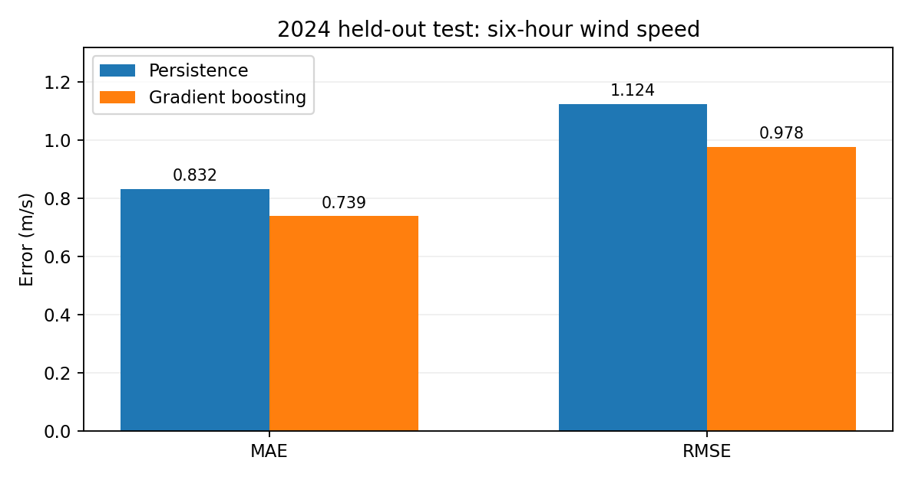
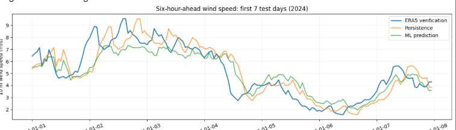

# Six-Hour-Ahead Wind-Speed Prediction | ERA5 + Machine Learning

An educational meteorology and machine-learning project predicting 10 m wind speed six hours ahead near Darmstadt, Germany. A histogram-based gradient boosting regressor is compared to a **persistence baseline** (current wind speed used as the six-hour prediction).

> This is a **retrospective reanalysis experiment**, not an operational forecast system. Historical ERA5 data may not be available at actual forecast issuance time.

## Held-out 2024 test results

| Model | MAE (m/s) | RMSE (m/s) |
|---|---:|---:|
| Persistence | 0.831849 | 1.124159 |
| **Histogram gradient boosting** | **0.738684** | **0.977797** |

Relative reductions against persistence: **11.20% MAE** and **13.02% RMSE** (8,778 test timestamps in 2024).





*The second figure is a screenshot of the original Colab plot covering the first seven days of 2024, not the full year.*

## Data and approach

- **Site:** near Darmstadt, Germany (49.8728°N, 8.6512°E).
- **Source:** [Open-Meteo Historical Weather API](https://open-meteo.com/en/docs/historical-weather-api), explicitly selecting the ERA5 model.
- **Period:** 2022–2024, hourly UTC; 26,304 records with no missing values in the downloaded variables.
- **Variables:** 10 m wind speed, 2 m temperature, 2 m relative humidity and mean sea-level pressure.
- **Predictors:** those four variables at lags 0, 1, 3, 6, 12 and 24 hours, plus cyclical time features; **28 total**.
- **Target:** 10 m wind speed at **t + 6 hours**.
- **Split:** 2022 for training (8,730 rows); 2023 for validation (8,754); 2024 as the held-out test year (8,778). Samples that would use a target from the next year are excluded.
- **Model selection:** best of three gradient boosting configurations selected on 2023 validation MAE; `max_iter=100`, `learning_rate=0.05`, `max_leaf_nodes=15`.
- **Final training:** retrain the selected configuration using 2022 + 2023, then evaluate once on the 2024 holdout.

## Run

1. Open `ERA5_Wind_6h_Prediction.ipynb` using [Google Colab](https://colab.research.google.com/).
2. Run the cells sequentially. Internet access is required for historical data. A GPU is unnecessary: scikit-learn gradient boosting uses the CPU.
3. The notebook saves a `wind_6h_model.joblib` checkpoint and test outputs. The model file and exported results are stored under `models/` and `results/`.

**Security:** `.joblib` files use pickle-based serialization. Never load untrusted checkpoints.

## Repository structure

```text
ERA5_Wind_6h_Prediction.ipynb
README.md
MODEL_CARD.md
requirements.txt
models/wind_6h_model.joblib
results/wind_6h_model_metrics.csv
results/run_metadata.json
results/test_metrics_comparison.png
results/wind_6h_prediction_screenshot.png
```

## Interpretation and limitations

The ML regressor improved both MAE and RMSE compared to persistence in this test. The first-week plot suggests that some higher-wind peaks are underestimated, although **no full-year extreme-wind verification** has yet been performed. Results are limited to one near-Darmstadt ERA5 grid point, without independent station validation or an operational NWP benchmark.

The held-out year is chronologically separated, but this retrospective test does **not** establish operational forecast performance. Real-time deployments require inputs available at issuance time, latency checks and additional independent evaluation.

## CV-ready summary

> Developed a six-hour-ahead wind-speed regression prototype using ERA5, lagged meteorological predictors and histogram gradient boosting; reduced MAE by **11.2%** relative to persistence on a chronological 2024 holdout.
